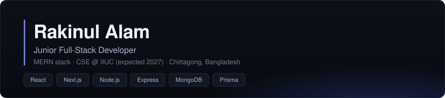
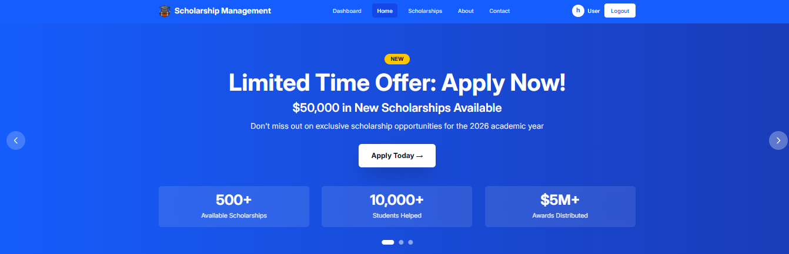
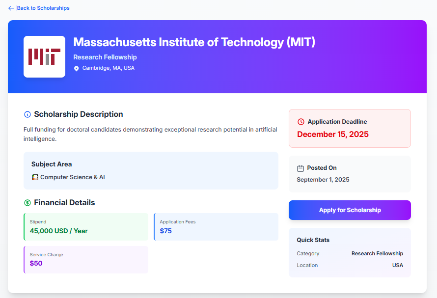

  

  
  
  
  

> [!NOTE]
> I'm open to internships and junior full-stack developer roles, and happy to collaborate on open-source projects.

## About

I'm a Computer Science and Engineering student at International Islamic University Chittagong, building full-stack web apps with the MERN stack. I care about clean, responsive interfaces, maintainable code that's well documented, and understanding how the parts of a system fit together.

**Right now**
- Building an e-commerce UI with responsive, accessible design
- Strengthening data structures and algorithms in C++
- Learning modern JavaScript patterns

  

## Tech Stack

**Core**

<picture>
  <source media="(prefers-color-scheme: dark)" srcset="https://skillicons.dev/icons?i=react,nextjs,nodejs,express,mongodb,prisma,js,html,css&theme=dark">
  
</picture>

**Also familiar with**

<picture>
  <source media="(prefers-color-scheme: dark)" srcset="https://skillicons.dev/icons?i=php,mysql,c,cpp,py&theme=dark">
  
</picture>

**Tools**

<picture>
  <source media="(prefers-color-scheme: dark)" srcset="https://skillicons.dev/icons?i=git,github,vscode,vercel&theme=dark">
  
</picture>

## Projects

| Project | Overview | Stack | Links |
|---|---|---|---|
| **Scholarship Management System** | Manages scholarship applications, eligibility, and the approval workflow. | MongoDB, Express, React, Node.js | [Source code](https://github.com/youknowmeright/Assaingment-12-Client) |
| **TutorsPoint** | Lets students search for and hire tutors by subject, location, and availability. | MongoDB, Express, React, Node.js | [Source code](https://github.com/youknowmeright/Tutors-Point-Client) |

  
  
   
  Scholarship Management System: dashboard (left) and application form (right)

<!-- TODO: add a TutorsPoint screenshot here once the UI is finalized -->

Live demos are coming soon. Each repository includes the full source, setup instructions, and a detailed README.

## GitHub Stats

  
  

## Contact

- **Email:** [YOUR_EMAIL@example.com](mailto:YOUR_EMAIL@example.com)
- **LinkedIn:** [linkedin.com/in/YOUR_LINKEDIN_HANDLE](https://www.linkedin.com/in/YOUR_LINKEDIN_HANDLE/)
- **Portfolio:** [YOUR_PORTFOLIO_URL](https://YOUR_PORTFOLIO_URL)
